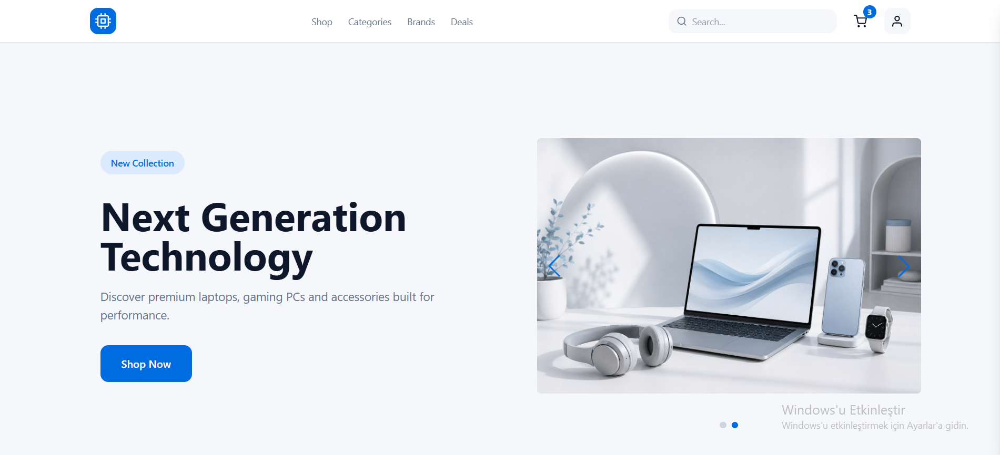
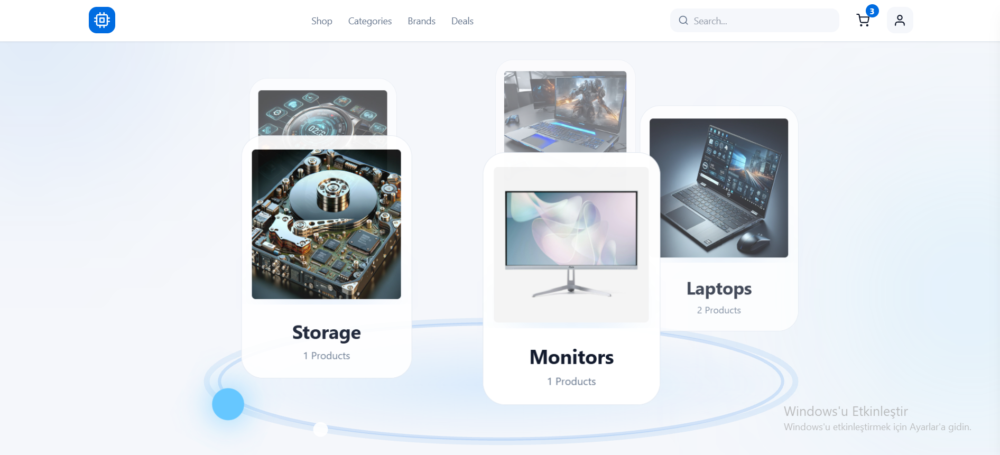
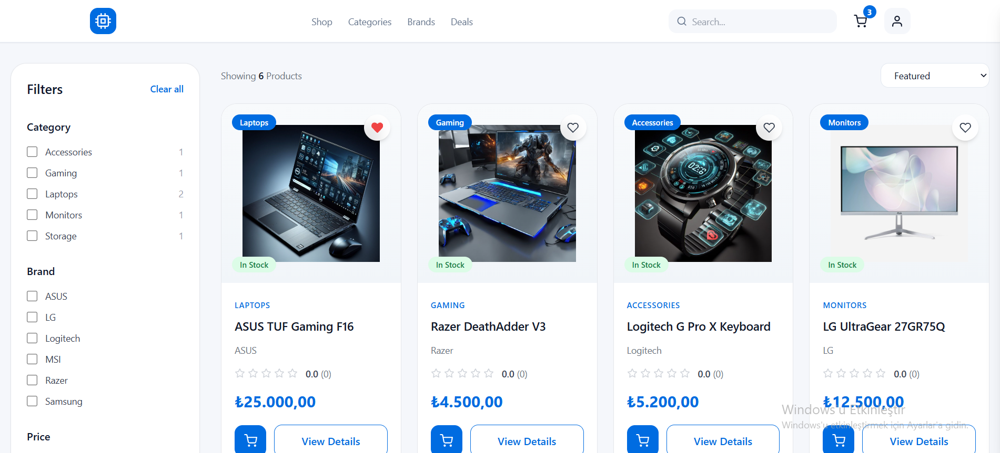
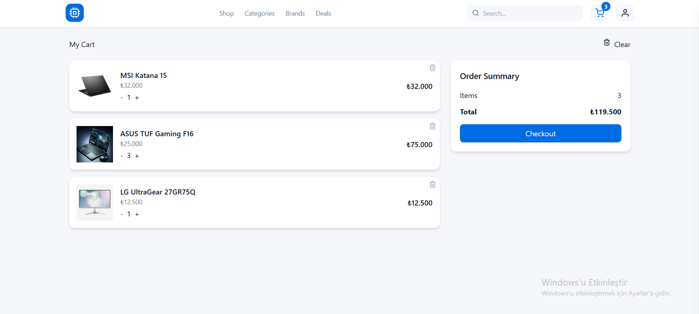
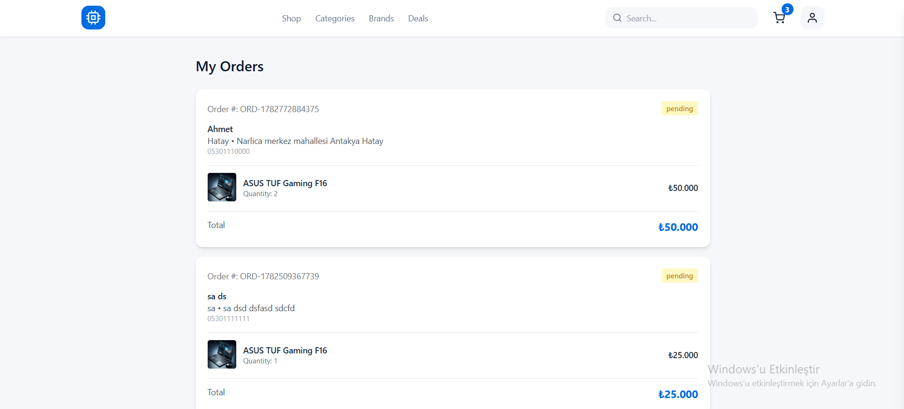
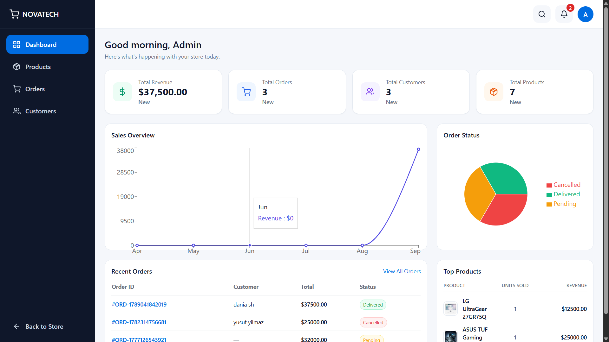

<p align="center">
  
</p>

# 💻 Novatech Store


A modern Full-Stack E-Commerce application built with React, TypeScript, Node.js, Express.js and MongoDB — with an integrated Stripe payment flow, cloud image storage, an AI-assisted product description generator, and a complete, data-driven admin dashboard.

Novatech Store was developed to strengthen my full-stack development skills by building a real-world e-commerce application from scratch. The project focuses on clean architecture, reusable components, responsive design, authentication, a full payment flow, and an admin panel where every number is computed from real data.

# 🚀 Live Demo

<p align="center">

[](https://ecommerce-frontend-lyart-one.vercel.app/)

## </p>

# 📑 Table of Contents

- Project Overview
- Features
- Tech Stack
- Architecture
- Project Structure
- Installation
- Environment Variables
- Learning Outcomes
- Roadmap
- Screenshots

---

# 📖 Project Overview

Novatech Store is a responsive MERN-style e-commerce application that simulates the core functionality of a modern online shopping platform.

Customers can create an account, securely authenticate, browse products, filter and sort items, manage their cart and wishlist, pay through a real Stripe Checkout flow, and track their orders.

On the admin side, the store owner has a role-protected dashboard to manage products (with AI-generated descriptions), fulfill orders, view customer insights, and monitor store performance — with no mock data anywhere in the admin panel.

---

# ✨ Features

## 🔐 Authentication

- User registration and login
- JWT authentication with protected routes
- Persistent authentication
- Role-based authorization (customer / admin)
- Secure password hashing using bcrypt

---

## 🛒 Shopping Experience

- Browse products and product detail pages
- Shopping cart
- Wishlist support
- Checkout with Stripe's hosted payment page
- Real-time payment status confirmation (success / cancel pages)
- Order history
- Responsive shopping experience

---

## 💳 Payments (Stripe)

- Stripe Checkout Sessions for secure, PCI-compliant payments
- Webhook-based payment confirmation (checkout.session.completed) with signature verification
- Order paymentStatus and status synced automatically once payment is confirmed
- Webhook tested locally with the Stripe CLI, and registered as a production endpoint

---

## 🔎 Product Discovery

- Filter by category, brand, availability, and price
- Sort by newest, price (low → high), price (high → low), and popularity

---

## 🎨 User Experience

- Responsive design
- Skeleton loading screens
- Toast notifications
- Animated landing page with a custom SVG orbit animation
- Popular Categories section
- Modern UI built with Tailwind CSS

---


## 👨‍💼 Admin Dashboard

### Products

- Full CRUD with a dedicated Add/Edit page
- Dynamic, category-specific specification fields
- Drag-and-drop multi-image upload, stored permanently on Cloudinary
- Search, filters, sorting, and pagination
- AI-generated product descriptions (Google Gemini) built from the product name, category, and specs — editable before saving
- Delete confirmation modal

### Orders

-Order status lifecycle management (pending → processing → shipped → delivered → cancelled)
- Order detail page with items, customer and shipping information
- Payment status and real card details (brand, last 4 digits, expiry) fetched from Stripe
- Visual status timeline
- Search, filters, sorting, and pagination

### Customers

- Per-customer statistics computed with MongoDB aggregation pipelines
- Total orders, total spent, and average order value
- Customer detail page with full order history

### Dashboard Analytics

- Revenue, orders, new customers, and new products KPIs
- Selectable period (7 / 30 / 90 days) with a like-for-like comparison against the previous period
- 6-month revenue trend chart
- Order status breakdown
- Recent orders and top-selling products

### Additional Admin Features

- Global search across products, orders, and customers
- Polling-based notifications for new orders and low-stock alerts
---


## 🛠️ Tech Stack

### Frontend


### Backend


### Development Tools


---

# 🏗️ Architecture

```text
            React + TypeScript (customer + admin)
                    │
                 Axios 
                    │
          Express.js REST API
                    │
        Controllers → Services → Models
                         │
   │             │                 │             │
MongoDB   Stripe (payments)     Cloudinary     Gemini
                                 (images)     (AI text)

```

---

# 📁 Project Structure

```text
e-commerce/
│
├── frontend/
│   ├── api
│   ├── components
│   ├── context
│   ├── hooks
│   ├── layouts
│   ├── pages
│   ├── features/admin
│   ├── services
│   ├── shared
│   ├── types
│   ├── utils
│   └── validation
│
└── backend/
    ├── controllers
    ├── middleware
    ├── models
    ├── routes
    ├── services
    ├── types
    └── validation
```

---


# ⚙️ Installation

## Prerequisites

Make sure you have the following installed:

- Node.js and npm
- MongoDB Atlas account
- Stripe account (for payment features)
- A Cloudinary account (free tier)
- A Google AI Studio API key (free tier) — for the AI description feature

## Clone the repository

```bash
git clone https://github.com/dania8shaghouri/e-commerce.git
cd e-commerce
```

## Backend Setup

Open a terminal in the project root:

```bash
cd backend
npm install
```

Create a `.env` file inside the `backend/` directory.

Add the required environment variables:

```env
MONGODB_URI=
JWT_SECRET=
PORT=3001
ALLOWED_ORIGINS=http://localhost:5173

STRIPE_SECRET_KEY=
STRIPE_WEBHOOK_SECRET=
FRONTEND_URL=http://localhost:5173
```

Start the backend development server:

```bash
npm run dev
```

## Frontend Setup

Open a new terminal in the project root:

```bash
cd frontend
npm install
npm run dev
```

The frontend will run on the local development URL provided by Vite.

---

🌱 Learning Outcomes

Throughout this project I improved my knowledge of:

- Building scalable React applications with reusable components (no prop drilling)
- Developing RESTful APIs with a layered architecture
- JWT authentication and role-based authorization
- Integrating third-party payments (Stripe Checkout + signature-verified webhooks)
- MongoDB aggregation pipelines for computed, data-driven views
- Integrating an LLM API: prompt design, limiting hallucinations, and keeping API keys server-side
- Persistent cloud file storage and why local disk storage fails on ephemeral hosts
- Context API state management
- Advanced TypeScript (generics, strict config, resolving form/schema type edge cases)
- Form handling and validation with React Hook Form and Zod
- Async UI patterns: debouncing, race-condition handling, skeleton loading, polling
- Full-stack deployment (Vercel + Render) and diagnosing real production issues
- Keeping multiple repositories and environments in sync

---


# 🚧 Roadmap

Planned improvements include:

### Testing & Quality

- Unit testing with Jest
- Component testing with React Testing Library
- Integration testing
- CI/CD pipeline with GitHub Actions

### Infrastructure

- Docker support

### E-Commerce Features

- Dedicated wishlist page 
- Product reviews and ratings
- Real shipping cost and discount system
- Coupon system
- Search suggestions
- Email verification
- Password reset

### Admin Improvements

- Mark as Paid manual override
- Order status history with per-step timestamps
- Settings & Analytics pages

### Future Improvements

- AI-powered product recommendations
---

# 📷 Screenshots

Explore some of the key pages of **Novatech Store**.

### 🏠 Home & Shop

| Home                             | Shop                             |
| -------------------------------- | -------------------------------- |
|  |  |

---

### 🛒 Shopping Experience

| Cart                             | Orders                             |
| -------------------------------- | ---------------------------------- |
|  |  |

---

### 👨‍💼 Admin Dashboard

<p align="center">
  
</p>
---
